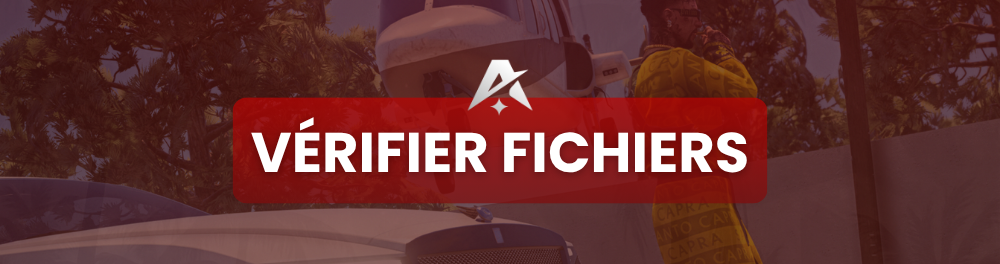

# 📂 Vérifier ses fichiers

<figure><figcaption></figcaption></figure>

Si GTA V **plante, crashe ou affiche des bugs persistants**, c'est peut-être qu'un **fichier de jeu est corrompu ou manquant**. La vérification d'intégrité répare ça automatiquement.


Cette opération **scanne** tes fichiers GTA V et **re-télécharge** uniquement ceux qui sont endommagés. Tes sauvegardes et réglages ne sont pas touchés.


***

## 🟦 Sur Steam

1. Ouvre **Steam** et va dans ta **Bibliothèque**.
2. **Clic droit** sur **Grand Theft Auto V** → **Propriétés**.
3. Onglet **Fichiers installés**.
4. Clique sur **Vérifier l'intégrité des fichiers du jeu**.
5. Patiente : Steam répare automatiquement les fichiers manquants.

***

## 🟪 Sur Epic Games

1. Ouvre le **launcher Epic Games**.
2. Va dans ta **Bibliothèque**.
3. Clique sur les **trois points (…)** sous **GTA V**.
4. Sélectionne **Vérifier (Verify)**.
5. Laisse le launcher analyser et réparer.

***

## 🟧 Sur Rockstar Games Launcher

1. Ouvre le **Rockstar Games Launcher**.
2. Va dans **Paramètres**.
3. Sélectionne **Grand Theft Auto V** dans la liste de gauche.
4. Section **Vérifier l'intégrité** → **Vérifier**.
5. Attends la fin de l'analyse.

***

## ⏱️ Bon à savoir

* L'opération peut durer de **quelques minutes à plus longtemps** selon ton disque.
* Si des fichiers sont réparés, **relance** GTA V puis FiveM.
* Combine avec [Vider son cache](vider-son-cache.md) pour un nettoyage complet.


**Mods sur GTA V solo ?** Ils peuvent corrompre tes fichiers et empêcher FiveM de fonctionner. Pour jouer sur Horizon RP, GTA V doit être **propre, sans mods**.


***

> Fichiers vérifiés et toujours un bug ? Vois la page [Bug de map](bug-de-map.md) ou ouvre un ticket sur le [Support](../support/support.md).
