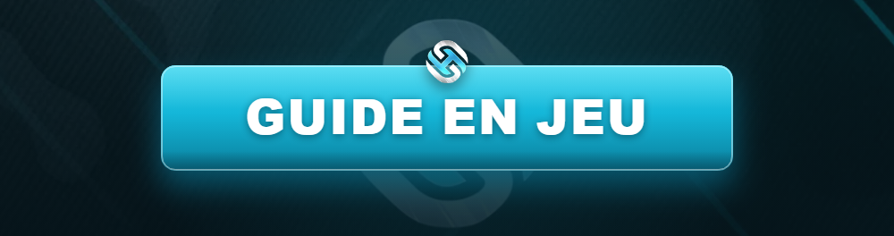

# 🔌 Connexion au serveur

<figure><figcaption></figcaption></figure>

Suis ce guide pas à pas pour rejoindre **Horizon RP**. Si tu n'as jamais joué sur FiveM, pas d'inquiétude : c'est simple et gratuit.

***

## ✅ Pré-requis


Tu dois **obligatoirement** posséder une copie **légale de GTA V** (Steam, Epic Games ou Rockstar Launcher) pour jouer sur FiveM.


* 🎮 **GTA V** installé et lancé au moins une fois.
* 🌐 **FiveM** téléchargé depuis le site officiel : [fivem.net](https://fivem.net).
* 💬 Un compte **Discord** pour accéder à la communauté.

***

## 📥 Étape 1 — Installer FiveM

1. Rends-toi sur [fivem.net](https://fivem.net) et clique sur **Download Client**.
2. Lance le fichier `FiveM.exe` et laisse l'installation se terminer.
3. Connecte-toi avec ton compte **CFX** (crée-en un si besoin).

***

## 🔎 Étape 2 — Rejoindre Horizon RP



1. Ouvre **FiveM**.
2. Clique sur l'onglet **Play** (icône de manette).
3. Dans la barre de recherche, tape **`Horizon RP`**.
4. Clique sur le serveur, puis sur **Connect**.



1. Rejoins notre **Discord** : [discord.gg/horizonrp](https://discord.gg/horizonrp).
2. Va dans le salon **#connexion**.
3. Clique sur le lien de connexion `cfx.re/join/xxxxxx`.
4. FiveM s'ouvre automatiquement et te connecte.



***

## ⏳ Étape 3 — Le chargement & la file d'attente

* À la première connexion, le serveur **télécharge les ressources** : cela peut prendre quelques minutes. C'est normal.
* En cas d'affluence, tu seras placé dans une **file d'attente**. Les **VIP** disposent d'une priorité (voir [Infos VIPs](../boutique/infos-vips.md)).


Ton jeu reste bloqué au chargement ? Consulte la page [Résolution de bugs](../bugs/README.md), notamment **Vider son cache**.


***

## 🎬 Étape 4 — Créer ton personnage

1. Une fois connecté, choisis ton **nom et prénom RP** (réalistes, pas de pseudo).
2. Personnalise ton apparence dans le **menu de création**.
3. Suis le tutoriel d'introduction.
4. **Bienvenue à Los Santos !** 🌅


Avant de te lancer, assure-toi d'avoir lu le [Règlement Général](../reglement/general/README.md). Bon jeu sur Horizon RP !

