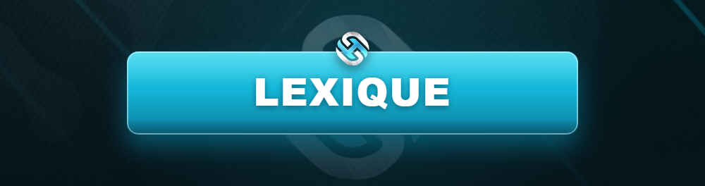

# 📚 Lexique RP

<figure><figcaption></figcaption></figure>

Le Roleplay possède son propre **vocabulaire**. Maîtriser ces termes est indispensable pour bien jouer et comprendre le règlement. Garde cette page sous la main !


Beaucoup de sanctions viennent d'une **mauvaise compréhension de ces termes** (RP/HRP, MG, PG…). Prends 5 minutes pour bien les apprendre.


***

## 🎭 Les bases

| Terme | Signification |
| ----- | ------------- |
| **RP** | _Role Play_ — tout ce qui se passe dans la peau de ton personnage. |
| **HRP** | _Hors Role Play_ — la vraie vie, hors du personnage (Discord, /ooc…). |
| **IC** | _In Character_ — dans le personnage. |
| **OOC** | _Out Of Character_ — hors du personnage. |
| **PNJ / NPC** | Personnage Non Joueur (géré par le jeu). |
| **Lore** | L'histoire et l'univers du serveur. |

***

## ⚔️ Termes d'action & de combat

| Terme | Signification |
| ----- | ------------- |
| **RvA** | _Roleplay vs Argent_ — privilégier le loot/l'argent au détriment du RP. **Interdit.** |
| **PowerGaming (PG)** | Forcer une action sur autrui sans lui laisser de réaction, ou se rendre invincible/irréaliste. **Interdit.** |
| **MetaGaming (MG)** | Utiliser des informations HRP dans le RP (Discord, stream, info hors-jeu). **Interdit.** |
| **FearRP** | Avoir peur pour la vie de son personnage de façon réaliste (ex : sous la menace d'une arme). **Obligatoire.** |
| **CarKill** | Tuer ou renverser volontairement quelqu'un avec un véhicule sans RP. **Interdit.** |
| **VDM** | _Vehicle Death Match_ — utiliser un véhicule comme arme sans RP. **Interdit.** |
| **RDM** | _Random Death Match_ — tuer/agresser sans raison RP ni interaction. **Interdit.** |
| **CombatLog** | Se déconnecter pendant une scène RP (combat, course-poursuite…). **Interdit.** |

***

## 💀 Mort & conséquences

| Terme | Signification |
| ----- | ------------- |
| **PK** _(Player Kill)_ | Mort temporaire : ton perso est soigné mais **perd la mémoire des dernières minutes**. |
| **CK** _(Character Kill)_ | Mort **définitive** du personnage. Nécessite des conditions strictes (voir règlement). |
| **Down / À terre** | État inconscient, en attente de soin ou de réanimation. |
| **NLR** _(New Life Rule)_ | Après un PK, tu ne reviens pas sur les lieux et oublies la scène. |

***

## 🏙️ Vie du serveur

| Terme | Signification |
| ----- | ------------- |
| **SASP** | _San Andreas State Police_ — la police du serveur. |
| **SAMS** | _San Andreas Medical Service_ — les secours / le SAMU. |
| **DOJ** | _Department Of Justice_ — la justice (avocats, juges). |
| **Zone Safe** | Zone où le combat et les actions hostiles sont interdits. |
| **Zone Gunfight** | Zone autorisée aux fusillades sous conditions. |
| **DEFCON** | Niveau d'alerte qui encadre le port d'armes et les braquages. |
| **Loot** | Récupérer les objets d'un joueur/PNJ. |
| **HderS** _(Hors de Soin)_ | Joueur ne pouvant plus être réanimé. |


Un terme manque ou n'est pas clair ? Demande sur le **Discord** dans le salon d'aide, le staff se fera un plaisir de t'expliquer.

