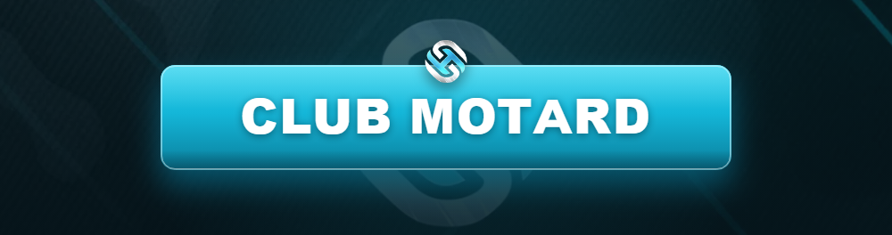

# 🏍️ Club Motard (MC)

<figure><figcaption></figcaption></figure>

Le **Club Motard** (_Motorcycle Club_) repose sur la **fraternité, l'honneur et la route**. Moins centré sur le territoire qu'un gang, le MC vit selon ses **codes** et son **business** propre.

***

## 🤝 L'esprit MC

Un MC est une **famille**. La loyauté, le respect des anciens et les traditions priment. On ne « rejoint » pas un MC, on le **mérite** après une période de prospect.


Le RP de MC est riche : cérémonies, patchs, sorties à moto, codes d'honneur. C'est l'un des RP de groupe les plus **immersifs** quand il est bien joué.


***

## 🎖️ Hiérarchie type d'un MC

| Titre | Rôle |
| ----- | ---- |
| **President** | Dirige le club, décision finale. |
| **Vice-President** | Seconde le président. |
| **Sergeant at Arms** | Sécurité et discipline du club. |
| **Road Captain** | Organise les sorties et la logistique. |
| **Treasurer** | Gère l'argent du club. |
| **Full Patch (Member)** | Membre à part entière. |
| **Prospect** | En période de probation. |

***

## 🛣️ Codes & traditions

* 🧥 Le **patch** (couleurs) se respecte et se mérite.
* 🏍️ Les **sorties à moto** font partie de l'identité du club.
* 🫡 **Respect des anciens** et de la chaîne de commandement.
* 🍻 Le **clubhouse** est le QG sacré du MC.

***

## 💼 Business & conflits

* Le MC peut mener des **activités illégales** (trafic, protection) dans le cadre autorisé.
* Les conflits suivent les **règles générales** : motif RP, [Zone Gunfight](../general/zone-gunfight.md), [DEFCON](../services-publics/defcon.md).
* Les **rivalités entre clubs** doivent être scénarisées.


Le MC n'est **pas** un gang de rue déguisé. Si ton « club » ne fait que du frag de territoire sans aucun code RP, il sera requalifié ou sanctionné.


***

## 🚫 Interdictions spécifiques

* ❌ Trahir l'esprit MC (recrutement éclair, zéro tradition).
* ❌ Porter les couleurs d'un club existant sans autorisation.
* ❌ Guerres permanentes sans histoire.

> Plus orienté quartier et territoire ? Vois le [Gang](gang.md). Tu joues seul ? Vois [Indépendant](independant.md).
