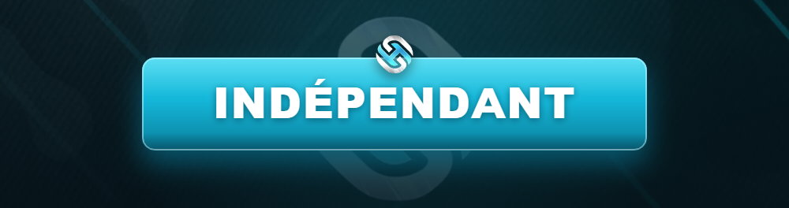

# 🎭 Indépendant

<figure><figcaption></figcaption></figure>

Tous les criminels n'appartiennent pas à un groupe. L'**indépendant** joue le crime **en solo** ou en **petit comité**, sans structure officielle. Liberté totale… mais cadre tout aussi strict.

***

## 🎯 Qui est l'indépendant ?

* Un **petit malfrat**, un dealer de quartier, un voleur à la tire.
* Un **duo / trio** d'amis qui font des coups sans fonder de groupe.
* Un personnage **infiltré** ou électron libre du milieu.


L'indépendant est parfait pour **débuter dans l'illégal** ou pour jouer un personnage plus discret, sans les responsabilités d'un groupe.


***

## 📏 Règles spécifiques

| Règle | Détail |
| ----- | ------ |
| **Effectif limité** | Un groupe d'indépendants reste **petit** (généralement 3-4 max). |
| **Pas de territoire** | Les indépendants ne revendiquent **pas** de zone. |
| **Pas de guerre de groupe** | Ils ne déclarent pas de guerre type gang/MC. |
| **Coups mesurés** | Activités à l'échelle « petite frappe », pas de méga-braquage organisé en boucle. |


Un groupe d'indépendants qui grossit et veut **territoire, guerre et gros business** doit **officialiser** un groupe via la [création de groupe](creation-de-groupe.md).


***

## ✅ Ce que tu peux faire

* 🔫 Petits braquages (commerces) selon le [DEFCON](../services-publics/defcon.md).
* 💊 Deal et trafic à petite échelle.
* 🚗 Vols de véhicules, cambriolages mesurés.
* 🤝 Collaborations ponctuelles avec d'autres joueurs.

***

## 🚫 Interdictions

* ❌ Se comporter comme un **gang** (territoire, guerre, effectif élevé) sans validation.
* ❌ Contourner les limites d'effectif en « appelant des potes » HRP.
* ❌ Enchaîner les gros coups sans RP ni respect du DEFCON.

***

## ➡️ Envie d'aller plus loin ?

Si ton aventure d'indépendant prend de l'ampleur, structure-toi officiellement :

<table data-view="cards"><thead><tr><th></th><th></th><th data-hidden data-card-target data-type="content-ref"></th></tr></thead><tbody><tr><td><strong>➕ Créer un groupe</strong></td><td>Officialise ton organisation.</td><td><a href="creation-de-groupe.md">creation-de-groupe.md</a></td></tr></tbody></table>
