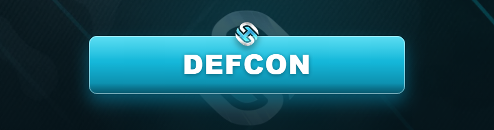

# 🚨 DEFCON

<figure><figcaption></figcaption></figure>

Le **DEFCON** est le **niveau d'alerte global** du serveur. Il définit ce qui est autorisé en matière de **port d'armes, braquages et affrontements**, afin d'équilibrer le RP entre légaux et illégaux.


Le niveau DEFCON est fixé par le **staff / la direction des services** selon l'activité du serveur. Il est communiqué **en jeu et sur le Discord**. Vérifie-le avant toute action armée.


***

## 📊 Les niveaux



🟢 **Activité normale, faible tension.**

* Port d'armes **discret uniquement** (armes de poing).
* **Braquages interdits** ou très limités.
* RP du quotidien privilégié.



🟡 **Tension légère.**

* Armes de poing autorisées en contexte RP.
* **Petits braquages** autorisés (commerces) sous conditions.
* Présence policière renforcée.



🟠 **Tension notable.**

* Armes de poing libres en RP, **armes longues sur contexte**.
* **Braquages moyens** autorisés (bijouterie, etc.).
* Effectif minimum de police requis.



🔴 **Forte tension.**

* **Armes longues autorisées** en contexte RP.
* **Gros braquages** possibles (banque) avec effectif suffisant.
* Affrontements de territoire encadrés.



⚫ **Alerte maximale (événementiel).**

* Armement lourd autorisé.
* Opérations majeures **encadrées par le staff**.
* Réservé aux **événements spéciaux**.



***

## ⚖️ Règles d'or du DEFCON

* 🔫 **Le port d'armes doit toujours correspondre au DEFCON en cours.** Sortir un fusil en DEFCON 5 est une faute.
* 👮 Les **braquages** nécessitent souvent un **effectif policier minimum** en ligne pour être lancés. Vérifie avant de braquer.
* 🚫 On ne « monte » pas le DEFCON soi-même : il est **décidé par le staff**.
* 🎭 Quel que soit le niveau, le **RP et le FearRP** restent obligatoires.


Lancer un braquage **sans respecter l'effectif policier requis** ou le DEFCON entraîne l'**annulation du butin** et une **sanction**.


***

## 📌 Avant chaque action armée, demande-toi :

1. Quel est le **DEFCON actuel** ?
2. Mon **armement** est-il autorisé à ce niveau ?
3. Y a-t-il **assez de policiers** en ligne pour mon braquage ?
4. Mon action est-elle **justifiée RP** ?

> Le DEFCON est ton repère n°1 pour toute activité illégale. Croise-le toujours avec le [Règlement Illégal](../illegal/README.md).
