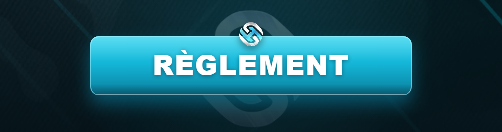

# 🌐 Règlement Général

<figure><figcaption></figcaption></figure>

Bienvenue dans le **règlement officiel d'Horizon RP**. Ce document constitue le **contrat moral** entre toi et la communauté. Il garantit un jeu **sain, équitable et immersif** pour tous.


**En te connectant sur Horizon RP, tu reconnais avoir lu et accepté l'intégralité de ce règlement.** Nul n'est censé ignorer les règles. Le staff applique ces règles sans favoritisme.


***

## 📚 Comment est organisé le règlement ?

Le règlement se divise en **trois grands volets**, à lire selon ton style de jeu :

<table data-view="cards"><thead><tr><th></th><th></th><th data-hidden data-card-target data-type="content-ref"></th></tr></thead><tbody><tr><td><strong>⚖️ Règles de base</strong></td><td>Les fondamentaux valables pour <strong>TOUS</strong> les joueurs.</td><td><a href="regles-de-base.md">regles-de-base.md</a></td></tr><tr><td><strong>🏛️ Services Publics</strong></td><td>Pour la police, les secours et les entreprises.</td><td><a href="../services-publics/README.md">README.md</a></td></tr><tr><td><strong>🔫 Illégal &#x26; Groupes</strong></td><td>Pour les gangs, MC et indépendants.</td><td><a href="../illegal/README.md">README.md</a></td></tr></tbody></table>

***

## 🧱 Les zones spéciales

Certaines zones de la map ont des **règles particulières** concernant le combat et les interactions hostiles :

<table data-view="cards"><thead><tr><th></th><th></th><th data-hidden data-card-target data-type="content-ref"></th></tr></thead><tbody><tr><td><strong>🟢 Zone Safe</strong></td><td>Aucune action hostile autorisée.</td><td><a href="zone-safe.md">zone-safe.md</a></td></tr><tr><td><strong>🔴 Zone Gunfight</strong></td><td>Fusillades autorisées sous conditions.</td><td><a href="zone-gunfight.md">zone-gunfight.md</a></td></tr></tbody></table>

***

## ⚠️ L'esprit du règlement

Au-delà des règles écrites, **trois principes** doivent guider chacune de tes actions :

1. 🎭 **Le RP avant tout** — tu joues un personnage, pas une partie à gagner.
2. 🤝 **Le respect** — IC comme HRP, aucune toxicité n'est tolérée.
3. 🧠 **Le bon sens** — si une action te paraît abusive, c'est probablement qu'elle l'est.


Le règlement ne peut pas tout prévoir. En cas de doute ou de situation non décrite, c'est le **bon sens** et l'**arbitrage du staff** qui priment.


***

## 🛑 Conséquences

Le non-respect du règlement entraîne des sanctions graduées : **avertissement, kick, ban temporaire ou définitif**, selon la gravité. Plus d'infos dans la section [Modération](../../support/moderation.md).

> Prêt ? Commence par les [⚖️ Règles de base](regles-de-base.md), elles s'appliquent à toi quel que soit ton rôle.
