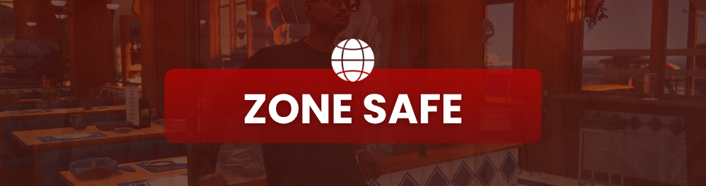

# 🟢 Zone Safe

<figure><figcaption></figcaption></figure>

Une **Zone Safe** est un lieu protégé où **aucune action hostile** n'est autorisée. Ces zones existent pour garantir des espaces de RP sereins et éviter les abus.

***

## 🚫 Ce qui est INTERDIT en Zone Safe

* ❌ Sortir une arme, menacer ou tirer.
* ❌ Braquer, kidnapper ou agresser un joueur.
* ❌ Voler un véhicule ou un joueur.
* ❌ Initier une course-poursuite ou un combat.
* ❌ Utiliser ces zones comme **refuge** pour échapper à un RP en cours.


**Utiliser une Zone Safe comme bouclier** (provoquer puis se réfugier pour éviter les représailles) est un abus sanctionné au même titre qu'une agression.


***

## ✅ Ce qui reste autorisé

* ✔️ Discuter et interagir en RP pacifique.
* ✔️ Faire du commerce et des activités légales.
* ✔️ Se soigner, se reposer, organiser un rendez-vous RP.

***

## 📍 Exemples de Zones Safe

| Zone | Pourquoi ? |
| ---- | ---------- |
| 🏥 **Hôpitaux & casernes** | Lieux de soin neutres. |
| 🏛️ **Commissariats & institutions** | Zones officielles protégées. |
| 🏦 **Banque centrale (hall)** | Hors braquage organisé et encadré. |
| 🛒 **Zones de spawn / accueil** | Protection des nouveaux joueurs. |
| 🚗 **Concessions & PDM** | Espaces commerciaux neutres. |


La liste exacte des Zones Safe et leurs limites est affichée **en jeu** et sur le **Discord**. En cas de doute sur une zone, abstiens-toi.


***

## ⚖️ En résumé

> Une Zone Safe = **zéro hostilité**. Ces espaces servent au RP calme et à la protection de tous. Pour le combat, direction la [Zone Gunfight](zone-gunfight.md).
