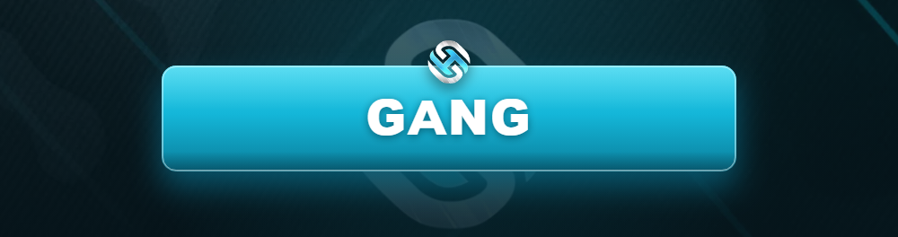

# 💀 Gang

<figure><figcaption></figcaption></figure>

Les **gangs** dominent la rue : territoire, trafic, influence et rivalités. C'est le cœur battant de la scène illégale d'Horizon RP.

***

## 🎯 L'esprit gang

Un gang, c'est avant tout une **identité de quartier** : des codes, des couleurs, une réputation. Le RP de gang repose sur le **contrôle de territoire** et les **rivalités** plus que sur le simple combat.


Un bon gang se **fait connaître par son RP** : tags, intimidation, business, alliances et trahisons. Le respect se gagne, il ne s'impose pas au fusil.


***

## 🗺️ Territoire

* Chaque gang validé peut revendiquer une **zone d'influence**.
* Le territoire se **défend et se conquiert** en RP (guerres scénarisées).
* Les **points de deal** et activités du territoire sont encadrés par le règlement.

***

## ⚔️ Conflits entre gangs

| Règle | Détail |
| ----- | ------ |
| **Motif RP** | Une guerre se déclare pour une raison (insulte, vol, territoire). |
| **Zones** | Les affrontements se font en [Zone Gunfight](../general/zone-gunfight.md). |
| **DEFCON** | Le port d'armes suit le [DEFCON](../services-publics/defcon.md). |
| **Membres impliqués** | Seuls les concernés RP participent. |
| **Trêve / fin** | Une guerre peut se terminer par négociation ou domination RP. |


**Pas de guerre permanente** : un conflit doit avoir un début, un déroulé et une fin RP. Se tirer dessus 24h/24 sans histoire est interdit.


***

## 💼 Activités typiques

* 💊 Trafic (drogue, armes…) dans le cadre autorisé.
* 🛡️ Racket et protection (mesurés, RP).
* 🏴 Contrôle de territoire et points stratégiques.
* 🤝 Alliances et rivalités avec d'autres groupes.

***

## 🚫 Interdictions spécifiques

* ❌ Cibler les **services publics** sans motif RP réel.
* ❌ Recrutement de masse pour dominer par le nombre.
* ❌ Guerre sans déclaration ni scénario.
* ❌ Loot total systématique des victimes.


Un gang qui ne fait que du **frag sans RP** sera rappelé à l'ordre, puis **dissous** en cas de récidive.


> Tu préfères la route et la fraternité ? Découvre le [Club Motard](club-motard.md). Tu joues solo ? Vois [Indépendant](independant.md).
