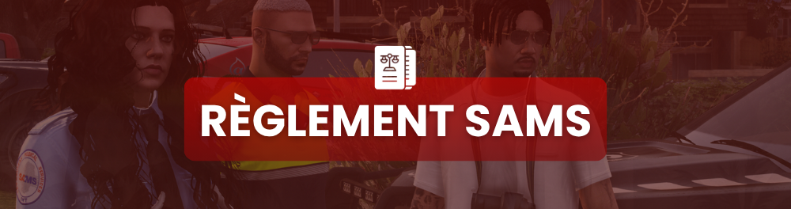

# 🚑 Règlement SAMS

<figure><figcaption></figcaption></figure>

Le **SAMS** (_San Andreas Medical Service_) prend en charge les blessés, sauve des vies et assure la continuité des soins. C'est un service **neutre et apolitique**, accessible à tous, même aux criminels.

***

## 🎯 Missions du SAMS

* 🚑 Répondre aux **appels d'urgence** et réanimer les blessés.
* 🩺 Assurer les **soins** sur le terrain et à l'hôpital.
* 🏥 Gérer les **admissions** et le suivi des patients.
* 🤝 Coopérer avec la **SASP** sur les interventions communes.

***

## ✅ Devoirs du personnel médical

* Porter une **tenue médicale** réglementaire.
* Faire preuve de **neutralité absolue** : on soigne **tout le monde**, sans distinction.
* Respecter le **secret médical** RP.
* Communiquer clairement et garder son sang-froid.
* Appliquer le **FearRP** : un médecin n'est pas invincible.


Le SAMS est **neutre**. Un médecin ne prend pas parti dans un conflit entre gangs et ne refuse jamais de soigner un patient pour des raisons personnelles.


***

## 🚫 Interdictions

* ❌ Refuser de soigner un patient pour un motif personnel/HRP.
* ❌ Participer à un conflit armé (le SAMS ne porte pas d'arme offensive).
* ❌ Divulguer des informations médicales hors cadre RP.
* ❌ Réanimer en pleine fusillade sans sécuriser la zone (mise en danger irréaliste).
* ❌ **MetaGaming** : utiliser une info médicale comme renseignement.

***

## 🩹 Procédure de prise en charge (résumé)

1. **Réception de l'appel** (numéro d'urgence / radio).
2. **Déplacement sécurisé** vers le lieu.
3. **Bilan** RP de l'état du blessé (`/me` examine la victime).
4. **Soins** ou transport vers l'hôpital.
5. **Suivi** et sortie du patient.


En **zone dangereuse**, le SAMS peut demander une **escorte SASP** avant d'intervenir. Foncer dans une fusillade pour réanimer est irréaliste et interdit.


***

## ⚰️ Mort & HderS

* Un blessé non secouru à temps peut passer **Hors de Soin (HderS)**.
* Le SAMS déclare alors une **prise en charge impossible** selon les règles de PK/CK.
* Le respect du **NLR** s'applique à la victime après réanimation.

> Le SAMS est le pilier humanitaire d'Astra. Pour rejoindre l'équipe, postule sur le **Discord** et suis la **formation médicale**.
